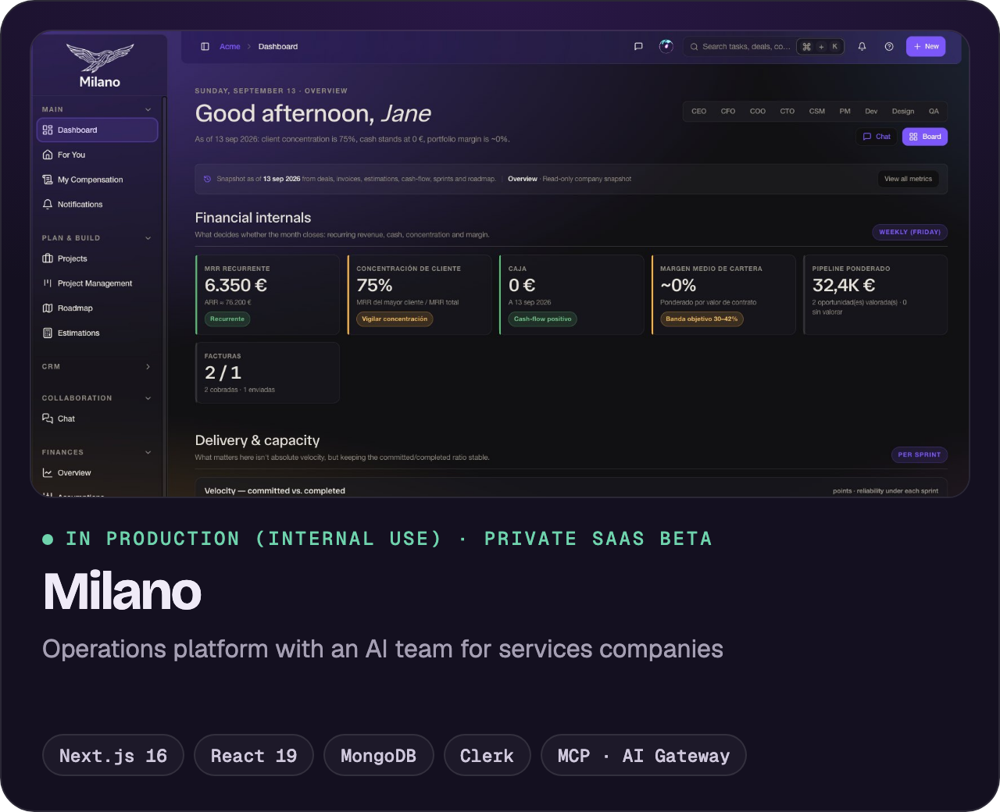
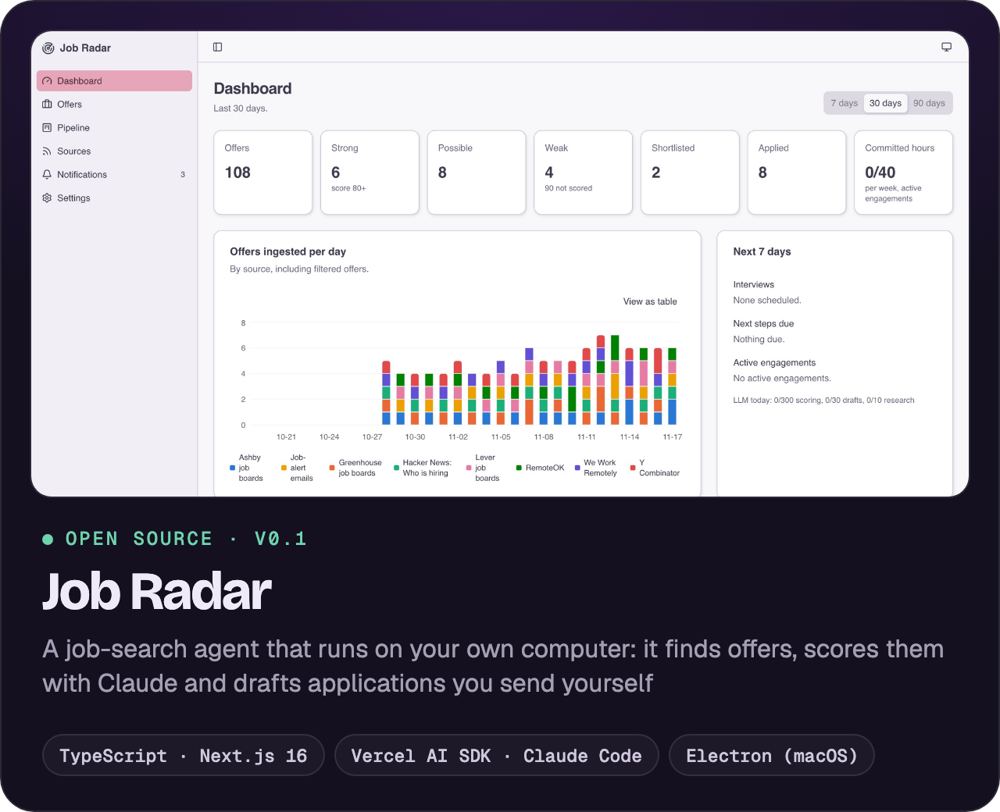
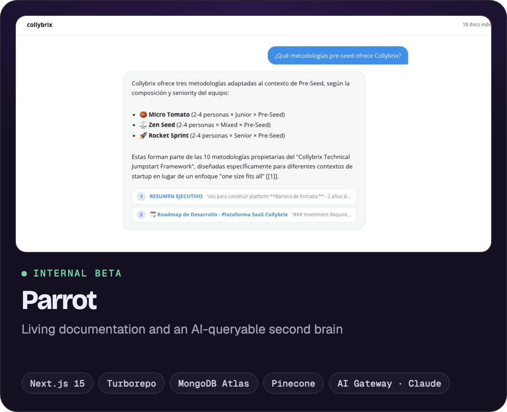
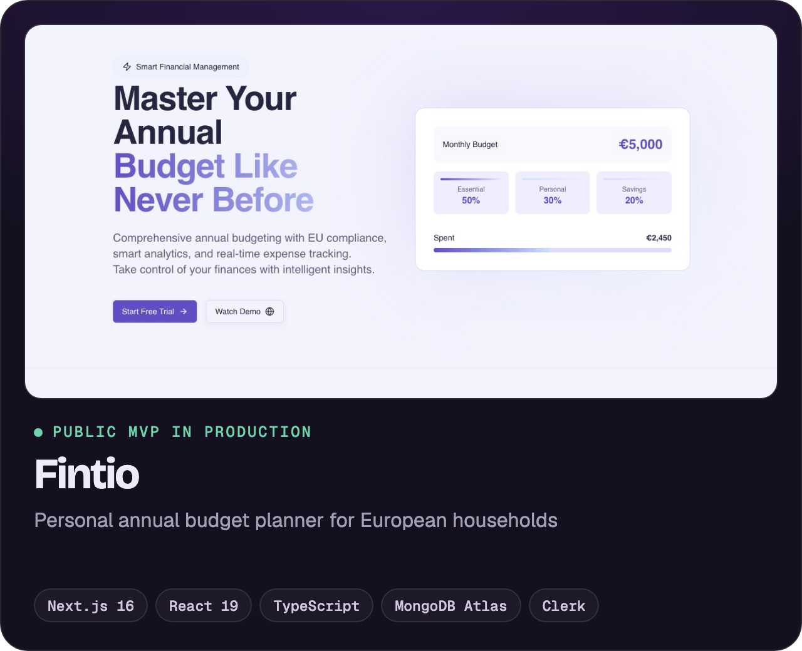
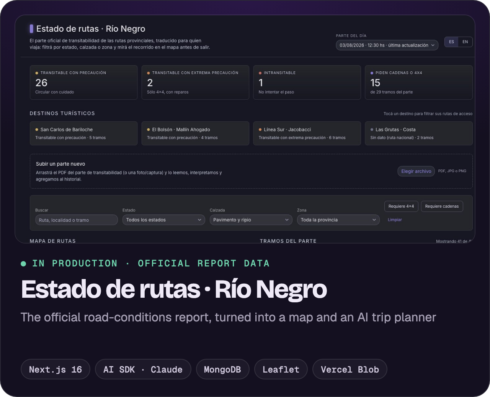
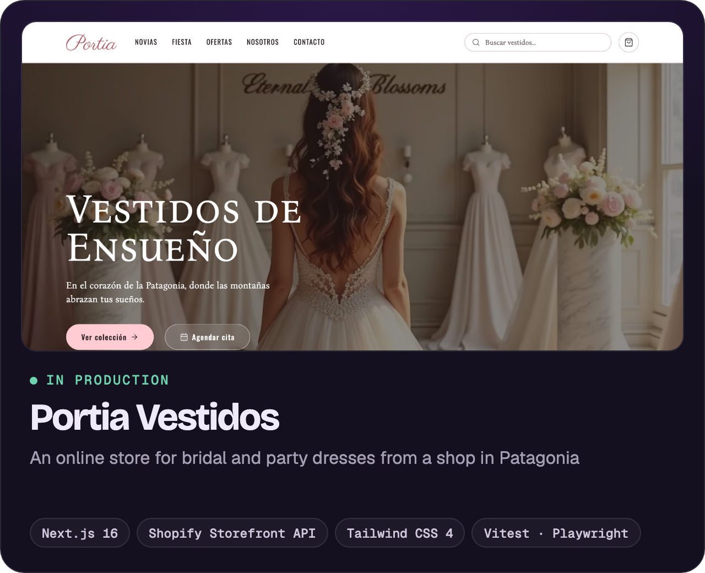
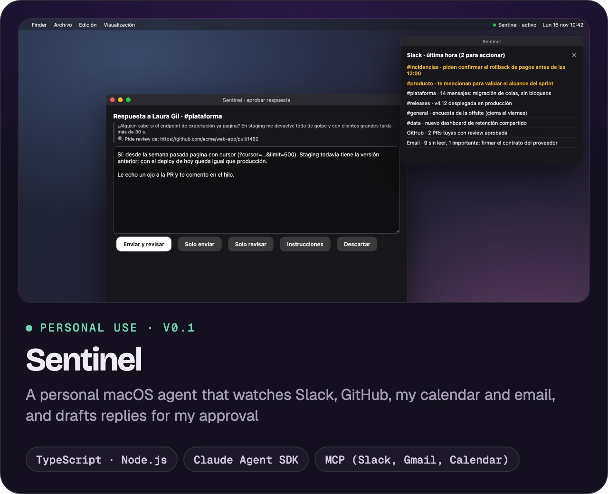
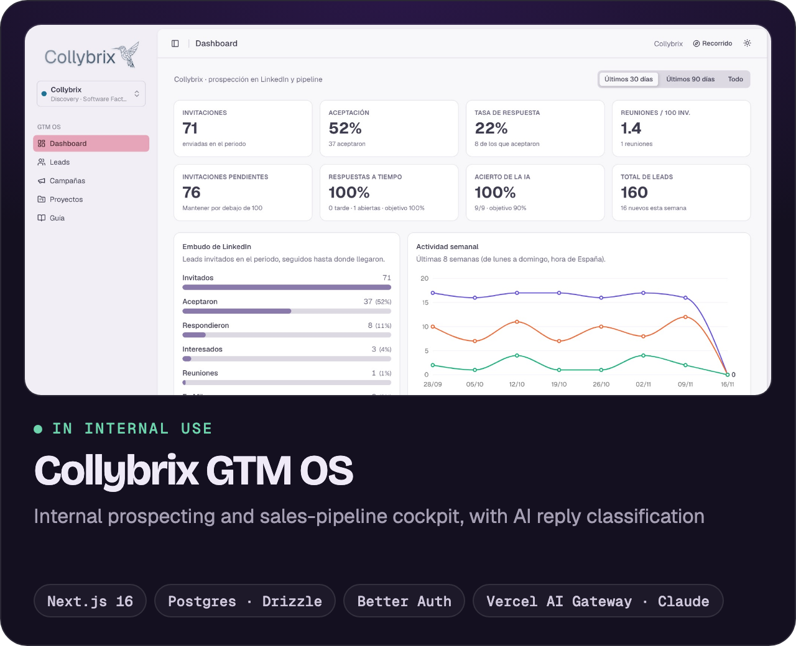

  
  
  
  

 

### ✦ Selected work

  
  

  
  

  
  

  
  

<a href="https://manumartinez.dev/en/projects">All projects, with the full story behind each one →</a>

### ✦ What I work with

  

  
  
  
  

### ✦ Latest from the blog

<!-- BLOG-POST-LIST:START -->
- [**PRDs for AI products: specifying when the model is the feature**](https://manumartinez.dev/en/blog/prds-for-ai-products) · Nov 11, 2026
- [**The accent**](https://manumartinez.dev/en/blog/el-acento) · Oct 9, 2026
- [**Founding a company in a country that isn't yours**](https://manumartinez.dev/en/blog/fundar-una-empresa-en-un-pais-que-no-es-el-tuyo) · Sep 10, 2026
<!-- BLOG-POST-LIST:END -->

<a href="https://manumartinez.dev/en/blog">Subscribe to the weekly newsletter →</a>

